


 

 

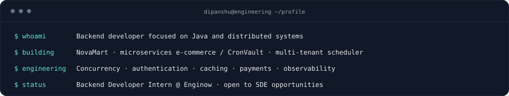

 

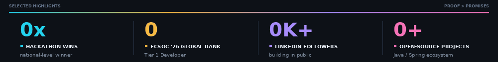

 

> **B.Tech CSE** student at **JMIT Radaur** (CGPA 7.9) and **Backend Developer Intern at Enginow**. I build **secure, scalable Java / Spring Boot systems** and care about the hard parts: exactly-once execution, concurrency, auth, caching and payments, all load-tested before I call them done.

 

**Elite Coders Summer of Code 2026: Global Rank 4 · Tier 1 Developer · full badge progression to Master**


 

<a href="https://github.com/dipanshubatra/nova-mart-ecommerce"></a>
<a href="https://cron-vaul-frontend-nine.vercel.app"></a>

**NovaMart:** [Source](https://github.com/dipanshubatra/nova-mart-ecommerce) · [Live demo](https://martnova.vercel.app/) &nbsp;|&nbsp; **CronVault:** [Live demo](https://cron-vaul-frontend-nine.vercel.app) (source is private)

 

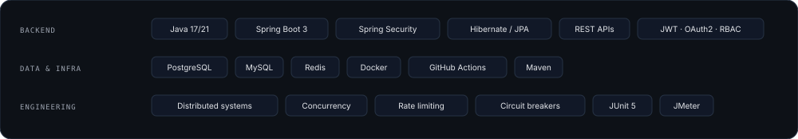

 

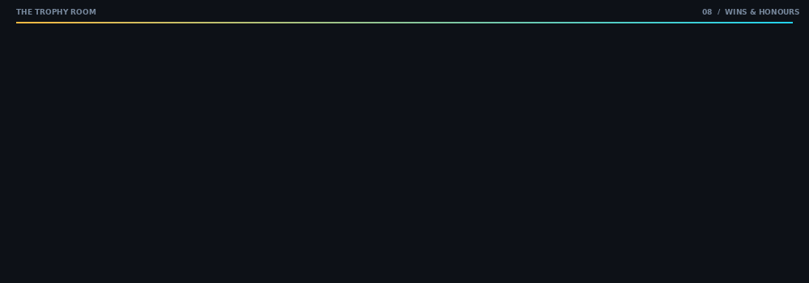

 


 

<a href="https://github.com/kRamu81/MedTrack_Application"></a>
<a href="https://github.com/Nicode2707/MailGenie"></a>
<a href="https://github.com/dipanshubatra"></a>

 

<picture>
  <source media="(prefers-color-scheme: dark)" srcset="https://raw.githubusercontent.com/dipanshubatra/dipanshubatra/output/github-contribution-grid-snake-dark.svg">
  <source media="(prefers-color-scheme: light)" srcset="https://raw.githubusercontent.com/dipanshubatra/dipanshubatra/output/github-contribution-grid-snake.svg">
  
</picture>


 

### Open to SDE & backend internships. Let's build something reliable together.

<!--
Keywords: Java Developer, Backend Engineer, Spring Boot Developer, REST API, System Design, Distributed Systems,
Multi-Tenancy, Docker, Redis, PostgreSQL, MySQL, JWT, OAuth2, RBAC, Rate Limiting, Circuit Breakers, JMeter,
Data Structures, Algorithms, Open Source, ECSoC 2026, Hackathon Winner, Backend Intern
-->
