 

 

## ⚡ About Me

> Final-year **Computer Science Engineering** student at **JMIT Radaur** who builds **scalable backend systems**, **secure REST APIs** and **production-ready software**. I like problems where correctness under load actually matters: locking, caching, auth, and payments.

<table>
<tr>
<td width="50%" valign="top">

### 🔭 Currently
- Building **CronVault**: distributed, multi-tenant cron scheduler with DB-level locking & RBAC
- Deepening **System Design & Distributed Systems**
- Shipping containerized backends with **Docker**

</td>
<td width="50%" valign="top">

### 🎯 Focus
- Backend Engineering · REST APIs
- AuthN/AuthZ: JWT, OAuth2, RBAC
- Redis caching & rate limiting
- **250+** LeetCode problems solved
- 🚀 **Open to SDE & Backend internships**

</td>
</tr>
</table>

 

## 🏅 ECSOC '26 · Elite Coders Summer of Code

**Completed the full progression, all the way to the Master tier.**

 

## 🏆 Achievements

| 🥇 1st Place | 🥇 1st Place | 🥇 1st Place | 🥇 1st Place |
|:---:|:---:|:---:|:---:|
| **TechFrontier 2025** IIIT Delhi · 500+ teams | **Hackastra** NIT Durgapur | **Ideathon 2026** JMIT Radaur | **Mukand Utsav 2K26** |

| 🚀 Finalist | 🛡️ Master Tier | 🤖 Certified | 🎓 Ambassador |
|:---:|:---:|:---:|:---:|
| **ByteVerse Hackathon** | **ECSOC '26** Contributor | **Oracle** AI Foundations Associate | **Campus Ambassador** IIT Delhi |

 

## 🛠️ Tech Stack

 

  

 

## 💡 What I Build

| | |
|---|---|
| 🧩 **Distributed systems** | Multi-tenant services with database-level locking |
| 🔐 **Secure auth** | JWT, OAuth2 and RBAC done properly |
| 💳 **Payments** | Cashfree-integrated backends |
| 📄 **Documented APIs** | Full Swagger / OpenAPI coverage |
| ⚙️ **Production-ready** | Redis caching, rate limiting, JMeter load tests |

 

## 🌍 Open Source

 

## 📊 GitHub Analytics

<picture>
  <source media="(prefers-color-scheme: dark)" srcset="https://raw.githubusercontent.com/dipanshubatra/dipanshubatra/output/github-contribution-grid-snake-dark.svg">
  <source media="(prefers-color-scheme: light)" srcset="https://raw.githubusercontent.com/dipanshubatra/dipanshubatra/output/github-contribution-grid-snake.svg">
  
</picture>

 

### 🤝 Let's build something reliable together

<!--
Keywords: Java Developer, Backend Engineer, Spring Boot Developer, REST API, System Design,
Distributed Systems, Multi-Tenancy, Docker, Redis, PostgreSQL, MySQL, JWT, OAuth2, RBAC,
Rate Limiting, Linux, Data Structures, Algorithms, Open Source, ECSOC 2026
-->
