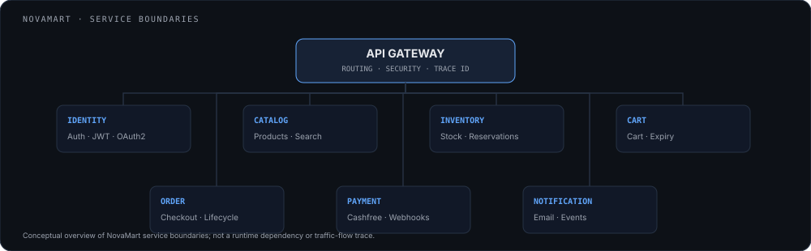
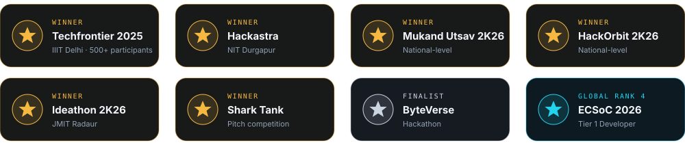

<!-- Premium profile layout: restrained typography, neutral surfaces, minimal motion. -->

[LinkedIn](https://linkedin.com/in/dipanshubatra) · [GitHub](https://github.com/dipanshubatra) · [LeetCode](https://leetcode.com/u/dipanshubatra) · [Portfolio](https://dipanshu-batra.vercel.app/)

## About

B.Tech CSE student at **JMIT Radaur** and **Backend Developer Intern at Enginow**. I build backend systems with Java and Spring Boot, with a focus on API design, authentication, concurrency, caching, payments and reliability.

## Selected projects

### [NovaMart — Distributed e-commerce platform](https://github.com/dipanshubatra/nova-mart-ecommerce)
[Live demo](https://martnova.vercel.app/)

- Eight independently deployable services covering gateway, identity, catalog, inventory, cart, order, payment and notifications.
- Built with Java, Spring Boot, Spring Security, PostgreSQL, Redis and React.
- Implemented reservation-based inventory, authentication flows and Cashfree payment integration.
- Load-tested with JMeter; benchmark details below.

### [CronVault — Multi-tenant job scheduler](https://cron-vaul-frontend-nine.vercel.app)
- Multi-tenant scheduling with role-based access, audit history and execution controls.
- Focus areas: reliable execution, database locking, Redis rate limiting and failure recovery.
- Source repository is private.

## System architecture

Conceptual service-boundary overview; it is not a live dependency or traffic-flow trace.

## Performance engineering

Historical JMeter run: 1,000 virtual users × 50 loops. Results are a benchmark snapshot, not live telemetry.

## Technical skills

## Achievements

**ECSoC 2026:** Global Rank 4 · Tier 1 Developer · completed progression to Master.

## Experience & journey

- **B.Tech CSE** — JMIT Radaur
- **Hackathon wins** — TechFrontier (IIIT Delhi), Hackastra (NIT Durgapur), Ideathon (JMIT Radaur) and others
- **ECSoC 2026** — Global Rank 4
- **Backend Developer Intern** — Enginow

## Open source

- [MedTrack Application](https://github.com/kRamu81/MedTrack_Application)
- [MailGenie](https://github.com/Nicode2707/MailGenie)
- [More projects on GitHub](https://github.com/dipanshubatra)

## GitHub activity

---

**Open to SDE and backend engineering opportunities.**

[LinkedIn](https://linkedin.com/in/dipanshubatra) · [GitHub](https://github.com/dipanshubatra) · [Portfolio](https://dipanshu-batra.vercel.app/)

<!--
Keywords: Java Developer, Backend Engineer, Spring Boot Developer, REST API, System Design,
Distributed Systems, Multi-Tenancy, Docker, Redis, PostgreSQL, MySQL, JWT, OAuth2, RBAC,
Rate Limiting, Circuit Breakers, JMeter, Data Structures, Algorithms, Open Source, ECSoC 2026.
-->
